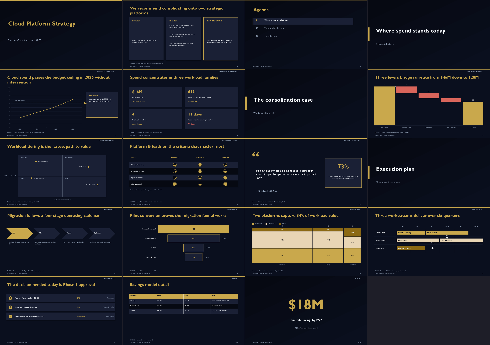
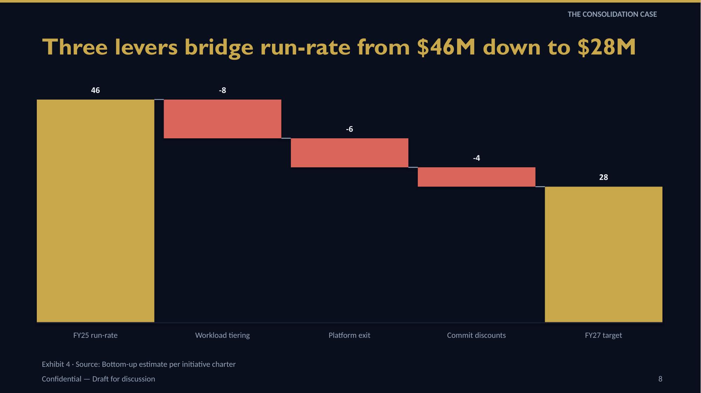

# Presenter Skill

A [Claude Code skill](https://docs.claude.com/en/docs/agents-and-tools/agent-skills) that generates **consulting-grade, natively editable PowerPoint decks** from markdown outlines — real `.pptx` files with proper shapes, charts, and placeholders, not slide images.

Built for tech-strategy work: action titles, SCQA executive summaries, value-bridge waterfalls, 2×2 matrices, harvey-ball scorecards, mekko charts, gantt roadmaps, exhibit sourcing, and a QA pipeline that checks every deck before delivery.



## Features

**39 layouts.** Core set (title, agenda, section dividers, bullets, two-column + chart/image, cards, stat callouts, timeline, comparison, table, full-bleed image, quote) plus a consulting set:

| Layout | Use |
|---|---|
| `waterfall` | Value bridges / cost walks with signed deltas and connectors |
| `matrix-2x2` | Effort/value prioritization with plotted items (add `Size=` for BCG-style bubbles) |
| `harvey-scorecard` | Vendor comparisons with real quarter-fill harvey balls |
| `mekko` | Market maps — column width ∝ size, height = share |
| `bar-mekko` | Profit pool: width ∝ market size, height = value/margin |
| `gantt` | Workstream swimlanes with phase bars + milestone diamonds; fiscal/month period expansion, Responsible/Remark columns, row brackets, shaded bands, milestone lines, `Parent > Child` rows |
| `exec-summary-scqa` | Situation \| Findings \| Recommendation |
| `chart-callout` | Chart + KEY INSIGHT box, optional dashed benchmark line |
| `dashboard` | KPI tiles with ▲▼ trend deltas |
| `heatmap-table` | Tables with per-column color-interpolated numeric cells (or `- Scale: rag`) |
| `comps-table` | Banking comps/precedents: decimal-aligned numeric columns, Mean/Median summary rows, NM cells |
| `tornado` | Two-sided sensitivity bars sorted by span, central driver spine |
| `football-field` | Valuation-range floating bars with optional marker line |
| `driver-tree` | Left-to-right value decomposition with elbow connectors |
| `stakeholder-map` | Support × influence grid with move arrows to target positions |
| `raci` | Activities × people with colored R/A/C/I letter chips |
| `architecture-layers` | Operating-model / stack layer bands with item chips |
| `swimlane-process` | Lane-per-actor process flow with step boxes |
| `org-chart` | Top-down governance / org hierarchy with roles |
| `value-chain` | Chevron value chain with sub-activities and support band |
| `what-how-who` | Chevron step header over a striped WHAT/HOW/WHO matrix |
| `tombstone-grid` | Bordered deal-credential cards in an auto grid |
| `league-table` | Shape-drawn ranked table with in-row percent bars |
| `logo-wall` | Uniform logo tile grid with contain-fitted images and captions |
| `funnel`, `big-number`, `process-flow`, `next-steps`, `quote-evidence` | …and more |



**Design system.** 10 built-in palettes (dark + light) with per-theme font stacks, WCAG-checked contrast, gradient hero slides, soft card shadows, icon bullets ([Tabler](https://tabler.io/icons)/[Lucide](https://lucide.dev) fetched + tinted automatically), inline rich text (`**bold**`, `{accent}…{/}`), multi-state bullets (a `rag:green` / `harvey:3` / `[x]` token prefix draws that state shape as the bullet marker), and two density tiers (compact two-column bullets by default). Custom brand palettes: drop a `<name>.json` file (9 required hex keys) into `<assets>/palettes/` and pass `--palette <name>` — or generate one straight from a company's web presence with `brand_kit.py <domain> --name acme` (Brandfetch API when keyed, CSS scrape fallback; classifies colors by luminance, derives contrast-safe text colors, downloads the logo). Image options `image:photo.png|alpha=85` and `|duotone` give brand-tinted, semi-transparent photos; decks containing CJK text automatically swap to a CJK-safe font stack (PingFang SC / Noto Sans CJK). A build-time overflow guard estimates line counts per text box, errors on catastrophic overflow, and writes `normAutofit` shrink (floor 80%) for marginal cases.

**Deck automation.** `**Auto-Agenda:** on|track` auto-inserts agenda slides from section-divider headings; `**Tracker:** tabs` adds a per-section chip strip on every content slide; `**Stamp:** DRAFT` (or CONFIDENTIAL / FOR DISCUSSION) adds a bordered tag on every slide, and per-slide `- Sticker: ILLUSTRATIVE` tags individual exhibits. PowerPoint sections are injected from divider headings (`**Sections:**`, on by default with 2+ dividers); `**References:** on` appends an auto-aggregated Sources backup slide. Heading attributes (`{layout=waterfall palette=aurora}`) set per-slide layout and palette inline — no separate directive line needed. Charts can pull data from CSV or Excel via `- Data-File: data/q3.csv` (`.xlsx` via optional openpyxl), with provenance stamped into speaker notes, and `gen_handout.py outline.md` emits a pre-read markdown handout (headings, prose bullets, tables, talk track, footnoted sources).

**Row-templated slides.** `**Repeat:** data/initiatives.csv [rows=1-20] [sort=owner]` on one slide expands it into one slide per data row, substituting `{column}` fields (plus `{row}` / `{rows}` builtins) into every string the slide carries — headings, bullets, cards, stat tiles, table rows, notes. `--check` reports `Slide N expands to K slides (file)`; 60+ expanded slides warn and 200+ are an error. The 50-initiative deck ("point it to the data source, agree on the design, crank them out") is one outline slide.

**Verbatim copy.** `**Copy:** locked` (or `--verbatim`) guarantees outline text lands in the deck byte-identical: no quote stripping, no `**bold**`/`{accent}` markup interpretation, and any builder truncation cap that would drop a row becomes a build error instead of a silent trim. `diff_deck.py` then compares raw — case, quotes and markers included — and fails on any deviation. For legal, regulatory and approved-messaging decks where "the tool helpfully rewrote my copy" is a defect, not a feature.

**Engagement profiles + memory.** `<assets>/profiles/acme.json` stores a client's standards — palette, footer, stamp, density, size, author, number format, style file, logo, banned phrases, mandatory slides, preferred layouts, notes style, page numbers, tracker — and `**Profile:** acme` / `--profile acme` applies them beneath the outline's own front-matter (CLI flag > variant preset (palette/density only) > outline front-matter > profile > default). A missing mandatory slide is a `--check` error; banned phrases join the house-style lints as warnings. `brand_kit.py <domain> --name acme --profile` writes one straight from a company's web presence. And `qa_summary.py --profile acme` appends findings that recur across runs to `<assets>/profiles/acme.lessons.md` — the institutional memory the skill reads before building the next deck for that client.

**Evidence ledger.** `**Evidence-File:** evidence.json` maps ids to citations (`{"E1": {"value": "42%", "source": "IDC 2026", "page": "12"}}`); slides cite them with `- Evidence: E1`. Referenced sources synthesize the slide's source footnote, full citations land in speaker notes, and the ledger activates a traceability gate: any slide with material statistics but no source or evidence reference is a fail-fast build error. `diff_deck.py` then verifies every referenced value survives into the built deck unchanged.

**Number discipline.** `**Number-Format:** units=M decimals=1 negatives=parens multiples=1x pct=1` sets one policy for every generated label — a unit suffix (appended, never rescaled), a decimal convention, and the banking negative style (`(3.2)` parentheses or a typographic en dash). `pct=` also drives every builder-drawn percentage (funnel conversions, the waterfall bracket, stacked-100/mekko shares, the CAGR arrow), and the policy is written onto native chart data labels as a number format so they read the same way if you switch them on in PowerPoint; `multiples=` is parsed but has no builder caller yet. Omit the directive and every label renders exactly as before, bar one disclosed exception — those percentages now round `.5` ties half-up and group thousands. Rounded parts are made to add up (largest-remainder) in waterfall deltas, stacked segments and stacked-100 labels, so a stack's labels sum to the stack's own label. `**Author:** "Name"` stamps the saved file's core properties, and every build now sanitizes the package on save (Keynote-safe slide size, the missing `notesMasterIdLst`, the vestigial `printerSettings` part, the stock python-pptx identity) — the trio that made Keynote and Quick Look refuse python-pptx files.

**House style.** `**Style-File:** style.json` (or `--style path`, or `<assets>/style.json`) drives editorial lints surfaced in `--check`: "not X but Y" constructions, marketing adjectives, hedges, judgemental phrasing about client teams, passive action titles, a tunable heading-length cap, duplicate and near-duplicate titles, title punctuation and sentence-vs-title-case drift (`"title_case": "any"` is the escape hatch for product-name-heavy decks), orphan footnote markers, and typography slips. Every key is optional and merges over sensible defaults.

**Chart intelligence.** `- CAGR: on` draws a growth arrow (single-series bar/column/line); `- Bracket: FY25, FY27` draws a waterfall difference bracket with auto-labeled % change; `- Axis-Max: N` pins the value axis for honest same-scale comparison — or let `**Scale-Group:** auto` compute a shared axis max across same-kind charts deck-wide. `- Value-Line: label, value` draws a dashed reference line on bar/column/line charts. Derived percentage labels use largest-remainder rounding so they always sum to 100, and `chart:stacked-100` supports `- Labels: pct|abs|both` dual data labels.

**Consulting discipline.** Action-title validation (the "titles test" via `--titles`, plus chart-slide-needs-a-number and split-the-slide lints), `- Source:` footnotes with optional exhibit numbering, `- Kicker:` bottom takeaway bands, section kickers, `## Appendix` backup slides, speaker-notes coverage warnings, purpose-aware narrative arcs. `--ghost` builds a skeleton deck (real titles, placeholder exhibits) for storyline sign-off before investing in content.

**QA pipeline.** `qa_check.py` catches out-of-bounds shapes, sub-10pt text, leftover placeholders, opaque chart backgrounds (the white-box-on-dark defect), and WCAG contrast failures — layer-aware, so text on cards is checked against the card. Its overflow estimate is font-true: `textfit.py` measures with the palette's actual TTF at PowerPoint's 1.2117 line pitch, and table cells get a literal point-size shrink because PowerPoint ignores autofit in cells. `editability.py` adds the "looks right, breaks on edit" class — a text box parked on a same-bounds shape, a connector anchored to nothing, sub-12pt text on a mostly empty slide. `--accessibility` mirrors the MS Accessibility Checker (unique titles, table header rows, real alt text, reading order); `--integrity` runs the Keynote/macOS package-hygiene checks and, with the optional `openxml-audit` package, OOXML schema validation. `geometry_report.py` reports deterministic per-slide layout metrics (overlaps, escapes-container spills, uneven spacing, near-miss alignment, whitespace, AeSlides centroid balance, word counts) before any render. `render_slides.py` produces LibreOffice thumbnails for visual review (grid cells are numbered so you can map thumbnails to slide numbers), reviewed against the binary, instance-specific checklist `qa_checklist.py` generates from the outline. `visual_regress.py` perceptual-hash-diffs a revision's thumbnails against the last delivered baseline so only intended slides change. `diff_deck.py` runs both directions — a dropped outline row is an error, deck text that traces back to nothing is flagged as phantom content, a native chart whose cache disagrees with its embedded workbook is warned about, and under locked copy (`--verbatim`, or auto-detected from the deck's own tags) the compare is raw and any deviation fails. `qa_check.py --numbers` is a separate numeric-token dump intended for LLM consistency checks. `pptx_lint.py` adds deck-wide cross-slide checks in fix order: page-number sequence, anti-jiggle, axis honesty, chart honesty (Misviz/Zelazny rules — truncated bar baselines and 3-D are errors), numeric consistency (mixed units/decimals/negative styles, a `Total` row that does not add up, one KPI with two values, a title number the exhibit never shows), palette color whitelist, typography, AI-tell heuristics, composition, `--gslides` Google Slides compatibility, and `--client-safe` pre-send scrubbing. `qa_summary.py` unifies the whole deterministic toolchain into one machine-readable `qa-summary.json` delivery record with a pass/fail verdict and the deck's L0–L5 editability level — usable directly as a CI gate; `--comments` writes a copy of the deck with every finding pinned to its slide as a PowerPoint comment, its stats count the reviewer comments still open vs resolved, and `--profile <name>` files recurring findings into that client's `lessons.md`.

**Client-safe delivery.** `pptx_lint.py --client-safe [--denylist terms.txt]` audits a finished deck for what must never ship: reviewer comments, hidden slides, and denylisted client or internal terms (they hide in slide masters and speaker notes) are errors; core-properties identity, off-slide and hidden shapes, unused layouts and masters, embedded chart workbooks, the stale package thumbnail and the presence of notes are warnings. `edit_deck.py clean --client-safe [--drop-notes] [--drop-hidden]` removes them, and `edit_deck.py sanitize-numbers` randomises every 3+ digit figure in slide text and chart caches (years survive) to turn a live client deck into a shareable sample. `save_hygiene.py` fixes the Keynote-hostile package defects on any foreign deck.

**Edit mode.** `edit_deck.py` unpacks existing decks to pretty-printed OOXML, supports duplicate/remove/reorder with correct relationship handling, and validates XML before repacking. `inventory` / `replace` subcommands enable bulk text edits via JSON without touching XML directly; `extract` splits a slide range into a new deck and `append` merges slides from one deck into another (parts renamed, rIds remapped, source styling preserved). `patch_deck.py` rebuilds one slide — or a batch (`"3,7,9"`, `"2-4"`) — from the outline and swaps it into an already-delivered deck, preserving hand edits everywhere else. Template mode maps outline slides onto an existing `.pptx`'s layouts by placeholder signature.

**Revision loop.** Generation takes an hour; revision takes twenty. Every slide this toolchain builds carries a `ppt/tags/` identity (outline key, layout, title hash, data hash, evidence ids, flags) and semantic shape names (`s04-chart-1`, `s04-kicker`) for the PowerPoint selection pane — so revision tools find a slide by *what it is*, not by where it sits, and survive a reviewer's hand reorder. On top of that: `edit_deck.py comments list|plan|apply|strip` reads a returned deck's reviewer comments (legacy and modern, with replies, resolved state and shape anchors), folds in an emailed `feedback.md`, and maps every item onto its outline slide and field as a `revision-plan.json`/`.md`; the mechanical ones (`delete bullet 3`, `replace "X" with "Y"`, `retitle: …`, `add bullet: …`, `move to slide 5`, `kill slide`, `split slide`, `merge with slide 6`) are applied to the outline idempotently, everything else is listed as `manual` for a human or Claude to write. `refresh_deck.py` re-reads every `Data-File:` binding, rebuilds only the slides whose data hash moved, and emits a change log of every number that changed (`Revenue@FY25: 12 → 14 (+2, +16.7%)`) with unpaired values listed rather than guessed at. `outline_ops.py` splits, merges, moves and renumbers slides in the outline itself, leaving every other byte untouched.

**Restyle mode.** `deck_to_outline.py old.pptx --output outline.md` recovers an existing deck's content — titles, bullets, tables, native-chart data, pictures (exported to assets), sources, speaker notes — into the outline format, with a per-slide fidelity report of anything that couldn't carry over. Chart numbers come from the **embedded workbook** behind the chart when it is readable (`chart_workbook.py` + optional openpyxl), not the XML cache, so an analyst's in-PowerPoint edit is recovered rather than the stale cached copy; the fidelity report speaks up only when the two disagreed or the workbook could not be read. The same reader gives `diff_deck.py` a cache-vs-workbook drift warning (an error under `--strict`). Review the outline, then rebuild on any palette or template: the "make this deck not ugly" path.

## Install

```bash
git clone https://github.com/rish2jain/Presenter-skill.git ~/.claude/skills/presentation-skill
pip install -r ~/.claude/skills/presentation-skill/requirements.txt
# optional, for high-fidelity visual QA + HEIC images + SVG icons:
brew install --cask libreoffice && brew install poppler
pip install pillow-heif cairosvg
# optional, much faster repeated QA renders (run `unoserver` in the background):
pip install unoserver
```

Claude Code discovers the skill automatically; asking for "a consulting deck on X" triggers it.

### Upload to Claude Desktop

Claude Desktop rejects skill zips with **more than 200 files**. Zipping the repo folder from Finder/macOS **includes `.git/` (~600+ files)** and fails.

Use the packaging script instead:

```bash
python3 scripts/package_skill.py
# → dist/presentation-skill.zip  (~90 files, correct folder wrapper)
```

Upload `dist/presentation-skill.zip` in **Settings → Capabilities → Skills**. The zip must contain `presentation-skill/SKILL.md`, not `SKILL.md` at the zip root.

## Quickstart (standalone, no Claude needed)

```bash
cd ~/.claude/skills/presentation-skill
python3 scripts/build_deck.py assets/example-outline.md --check     # validate
python3 scripts/build_deck.py assets/example-outline.md --output deck.pptx
python3 scripts/qa_check.py deck.pptx                               # programmatic QA
python3 scripts/pptx_lint.py deck.pptx --palette midnight-executive # deck-wide lint
python3 scripts/pptx_lint.py deck.pptx --client-safe                # pre-send scrub
python3 scripts/render_slides.py deck.pptx --grid --out thumbs/     # visual QA
python3 scripts/qa_summary.py deck.pptx --outline assets/example-outline.md \
    --palette midnight-executive --output qa-summary.json           # delivery record
```

Revision loop, once the deck has been delivered and come back:

```bash
python3 scripts/edit_deck.py comments list reviewed.pptx                    # what the reviewers said
python3 scripts/edit_deck.py comments plan reviewed.pptx --outline outline.md \
    [--feedback feedback.md] --output revision-plan                         # → .json + .md
python3 scripts/edit_deck.py comments apply revision-plan.json outline.md   # mechanical edits
python3 scripts/outline_ops.py outline.md split 4 --in-place                # split/merge/move/renumber
python3 scripts/patch_deck.py outline.md reviewed.pptx "3,7,9" --output revised.pptx
python3 scripts/edit_deck.py comments strip revised.pptx --all --output clean.pptx
python3 scripts/refresh_deck.py outline.md delivered.pptx \
    --output refreshed.pptx --log refresh-log.md [--dry-run]                # new numbers only
```

Outline syntax in a nutshell:

```markdown
**Palette:** midnight-executive
**Footer:** "Confidential"
**Page-Numbers:** on
**Exhibits:** on

## Slide 1: Three levers bridge run-rate from $46M down to $28M
**Layout:** waterfall
**Data:**
- FY25 run-rate: 46
- Workload tiering: -8
- Platform exit: -6
- Commit discounts: -4
- FY27 target: total
- Bracket: FY25 run-rate, FY27 target
- Source: "Bottom-up estimate per initiative charter"
- Notes: "Walk the bridge left to right."
```

Full syntax for every layout: [`references/generation-guide.md`](references/generation-guide.md). Storyline discipline (SCQA, dot-dash, titles test): [`references/storyline.md`](references/storyline.md).

## Tests

```bash
python3 -m pytest tests/      # 1,140+ tests
python3 scripts/smoke_test.py # build + QA the example deck end-to-end
```

## Repository layout

```
SKILL.md            entry point — phases, modes, QA protocol
references/         lazily-loaded guides (generation, storyline, editing, QA, ...)
scripts/            build_deck, builders(+consulting/exhibits), charts,
                    numfmt, evidence, house_style, narrative, save_hygiene,
                    qa_check, pptx_lint, chart_lint, numeric_lint,
                    client_safe, editability, shape_groups, content_trace,
                    geometry_report, qa_checklist, qa_summary,
                    outline_replay, outline_expand, outline_ops, slide_tags,
                    verbatim, profiles, chart_workbook, refresh_deck,
                    pptx_comments, revision_plan(+grammar/apply),
                    visual_regress, edit_deck, patch_deck,
                    deck_to_outline, render_slides, brand_kit, ...
tests/              pytest suite
assets/             example outline
```
